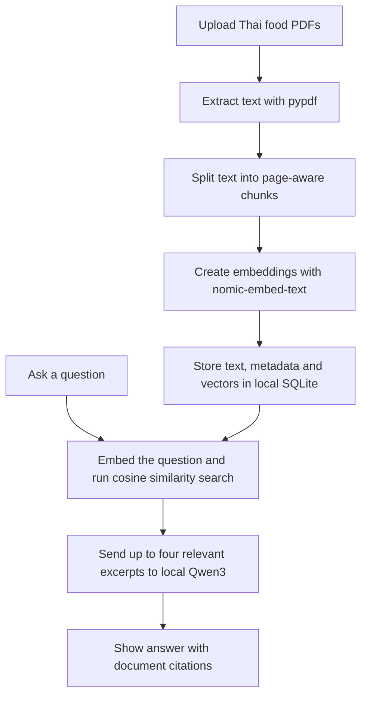

# 🍜 Aomini

### What Should I Eat? — Your AI Thai Food Companion

> Hungry? Not sure what to eat? Let Aomini decide!


*Aomini homepage concept preview. The current application interface may differ from this design reference.*

---

## 🌟 About Aomini

**Aomini** is a local AI-powered Thai food assistant built around one everyday question:

**“What should I eat today?”**

Upload your own Thai food PDFs—such as menus, food guides, or class notes—and ask questions about their contents. Aomini searches those documents and gives the relevant excerpts to a local language model to help you explore dishes, ingredients, and food preferences.

The application starts with an **empty document collection**. It does not include a built-in food database or sample restaurant prices. Budget and ingredient questions depend on information actually present in your uploaded documents.

## 🎯 Our Goal

To explore how **local knowledge and generative AI** can work together to provide practical food recommendations, with sources that users can check for themselves.

The project focuses on Thai cuisine and everyday food choices in Thailand.

## ✨ What You Can Do

- **Build a document collection:** upload multiple PDFs through the browser using the file picker or drag and drop. You can add five or more documents; five is not a collection limit.
- **Follow indexing progress:** see filenames, page counts, chunk counts, and indexing status. Failed documents show an error and a **Retry** button.
- **Ask about your PDFs:** use natural-language questions to find dishes or information supported by your collection.
- **Check the evidence:** answers can include numbered citations, source filenames, PDF page links, and expandable retrieved excerpts.
- **Open original documents:** click a filename to view its PDF in a new tab.
- **Manage your collection:** delete a PDF together with its stored text and embeddings after indexing finishes.
- **Get an accurate document list:** ask **“What documents are in my collection?”** The app reads stored filenames and statuses directly, without asking an AI model to guess.

## 💻 Set Up on macOS

### 1. Install the prerequisites

You need:

- **Python 3.10 or newer**, available from [python.org](https://www.python.org/downloads/macos/).
- **Git**, to clone the repository. If `git --version` prompts you to install Apple's Command Line Tools, follow the macOS installer.
- **Ollama for macOS**, available from [Ollama](https://ollama.com/download/mac). Install it in **Applications**, open it, and follow the setup prompts so the `ollama` command is available in Terminal. See the [official macOS installation guide](https://docs.ollama.com/macos) for current system requirements.
- A browser and one or more **text-based PDFs** containing Thai food information.

Check that the commands are available:

```bash
python3 --version
git --version
ollama --version
```

Internet access is needed to install packages and download the models. With the default local Ollama setup, document indexing and chat run on your computer without a cloud API key.

### 2. Open the project folder

For a fresh clone:

```bash
git clone https://github.com/OfficialJOLO/Aomini.git
cd Aomini
```

If you already have the repository at `~/Desktop/Aomini-github`, use this instead:

```bash
cd ~/Desktop/Aomini-github
```

Run the following project commands from the folder containing `app.py` and `requirements.txt`.

### 3. Create a Python environment and install packages

A virtual environment keeps this project's Python packages separate from other projects:

```bash
python3 -m venv .venv
source .venv/bin/activate
python -m pip install -r requirements.txt
```

The dependencies are **Flask 3.1.3**, **pypdf 6.21.4**, and **requests 2.34.2**. SQLite and the test runner are included with Python.

### 4. Start Ollama and download the models

Keep the Ollama desktop app running. If you prefer running Ollama from Terminal, open a **separate terminal window** and run:

```bash
ollama serve
```

Leave that window open. If Ollama is already running, you do not need to start a second server.

In your **project terminal**, download both required models:

```bash
ollama pull qwen3:1.7b
ollama pull nomic-embed-text
ollama list
```

Model downloads can take time and require additional disk space. Both model names should appear in `ollama list` (`nomic-embed-text` may appear with a `:latest` suffix).

### 5. Run Aomini

With your virtual environment active, run:

```bash
python app.py
```

Open **[http://127.0.0.1:5000](http://127.0.0.1:5000)** in your browser. The app uses the local Ollama service at `http://127.0.0.1:11434` by default.

Keep Flask and Ollama running while using Aomini. To stop Flask, press **Control+C** in its terminal.

For later sessions, you only need to open the project folder, activate the environment, ensure Ollama is running, and start the app:

```bash
cd ~/Desktop/Aomini-github
source .venv/bin/activate
python app.py
```

If you cloned into a different folder, adjust the `cd` command to match it.

## 📚 Use Your Document Collection

1. Check that the page reports **Local models ready**.
2. In **Document collection**, choose **browse files** or drop PDFs onto the upload area. You can select multiple files together.
3. Wait for each document to move through **Queued → Indexing → Ready**. The app indexes one document at a time in the background; only Ready documents are searched.
4. Ask a question in **Chat**. For example:
   - “Which dishes in my documents are spicy?”
   - “What ingredients are listed for Pad Kra Pao?”
   - “Do these documents mention any meals under 100 baht?”
   - “What documents are in my collection?”
5. Read the answer, expand **View retrieved excerpt**, and open the cited PDF page to check the source.

Price questions can only be answered when the PDFs provide the relevant prices. The model is instructed to say when the documents do not support a claim, rather than invent prices, ingredients, or restaurant details.

Use **Retry** after fixing an indexing error, such as a missing Ollama model. Use **×** to delete a document and its index; deletion is blocked while that file is queued or indexing. **New conversation** clears the visible chat, while documents remain in the collection.

Each question is answered independently. Earlier chat messages remain visible on the page but are not sent to the model as conversation history. Reloading the page clears chat messages; uploaded documents persist locally.

### PDF requirements

- Maximum **20 MB per file**, **150 pages**, and **800 extracted text chunks**.
- Use readable, text-based PDFs. Image-only scans need OCR before uploading; Aomini does not perform OCR itself.
- Password-protected PDFs are not supported.
- Unusual fonts, complex layouts, and menu tables can affect text extraction. Check the retrieved excerpts if an answer looks incomplete.

## 🧠 How Local RAG Works

**RAG** means *retrieval-augmented generation*: the app searches your documents first, then supplies the matching text to the language model when it asks for an answer.



An **embedding** is a list of numbers representing the meaning of text. Aomini compares a question's embedding with the stored document embeddings to find relevant passages.

Text is extracted page by page and divided into chunks of up to **900 characters**, with **150-character overlap** within a page. The app uses `nomic-embed-text` for both document and query embeddings, then performs a simple cosine similarity search in Python over vectors stored in SQLite. It retrieves up to four excerpts with a similarity score of at least 0.35.

**Qwen3 (`qwen3:1.7b`)** generates the answer using those excerpts. Thinking is disabled and temperature is set to 0. Uploading PDFs indexes them for retrieval; it does not train or fine-tune either model.

### Document citations

- A marker such as **[1]** identifies a retrieved excerpt used by the answer.
- The source link below the answer shows the **original filename and PDF page number**.
- **View retrieved excerpt** displays the stored text passed to the model.
- Clicking the source link opens the original PDF with a page reference. Numbers refer to physical PDF pages starting at 1, which may differ from printed page labels.
- Source filenames and links come from stored document metadata. They are not generated by the model.

When there are no ready documents, no matching excerpts, or an explicit unsupported-information response, the app explains that it cannot provide a supported answer. Generated answers with missing or out-of-range numbered citations are withheld.

These checks validate citation identifiers, not every factual claim. A small language model can still make mistakes or overlook relevant text, so use the excerpts and original PDFs to verify important details.

## 🔒 Local Storage and GitHub

**Uploaded PDFs are stored on the computer running Aomini. They must not be committed to GitHub.** The default local storage is created automatically on first run:

```text
instance/
├── aomini.sqlite3          # Filenames, statuses, extracted text and embeddings
└── uploads/
    └── <generated-id>.pdf  # Original PDFs stored under generated filenames
```

The database retains the original display filenames and page references. In the default configuration, the app sends questions and retrieved text to Ollama on the same computer.

The repository's `.gitignore` already excludes `instance/` and the `.venv` environment. **It does not ignore every PDF or database placed elsewhere in the repository.** Keep source PDFs outside the repository before uploading, and keep any custom data folder outside the repository too.

Commit source code, templates, static assets (including the homepage preview image), tests, `requirements.txt`, and documentation. Do not commit PDFs, uploads, databases, generated embeddings, virtual environments, model downloads, or secrets. Inspect `git status --short` before every commit; `.gitignore` does not remove files that Git already tracks.

## 🛠️ Tech Stack

| Technology | Purpose |
|---|---|
| Python + Flask | Local web server, routes, and background indexing queue |
| HTML / CSS / JavaScript | Chat and document collection interface |
| Ollama | Run both AI models locally |
| Qwen3 (`qwen3:1.7b`) | Generate answers from retrieved PDF excerpts |
| `nomic-embed-text` | Create document and question embeddings |
| `pypdf` | Extract PDF text and page references |
| SQLite + Python cosine similarity | Store metadata, text, and JSON vectors; search locally |
| `requests` | Communicate with the local Ollama HTTP API |

## 📁 Project Structure

```text
Aomini/
├── app.py
├── knowledge.py
├── requirements.txt
├── README.md
├── TEST_RESULTS.md
├── .gitignore
├── aomini-preview.png
├── templates/
│   └── index.html
├── static/
│   ├── style.css
│   ├── script.js
│   └── favicon.svg
└── tests/
    ├── __init__.py
    ├── pdf_fixture.py
    ├── test_app.py
    └── test_live.py
```

`instance/` and `.venv/` are created locally and are not part of the source repository. A fresh clone starts with no uploaded documents, so an instructor can add their own PDFs.

## 🧪 Run the Tests

From the project folder with the virtual environment active:

```bash
python -m unittest tests.test_app -v
```

These application tests use a fake Ollama client, real PDF extraction, and temporary local storage. They do not require running models.

To check the full pipeline with both real models installed and Ollama running:

```bash
AOMINI_LIVE_TESTS=1 python -m unittest tests.test_live -v
```

The live test creates five temporary synthetic PDFs and checks indexing, document listing, original PDF serving, a cited ingredient answer, and a response to an absent restaurant price. It removes its temporary collection afterward. `python -m unittest discover -v` runs all tests but skips the live test unless `AOMINI_LIVE_TESTS=1` is set.

See [TEST_RESULTS.md](TEST_RESULTS.md) for recorded verification results and their limits, including the use of English-language synthetic food notes rather than real user-provided Thai-language PDFs.

## 🔧 Troubleshooting

| Problem | What to do |
|---|---|
| `python3` or `ollama` is not found | Complete the relevant installation, reopen Terminal, and check the version command again. |
| `No module named flask` or another import error | From the project folder, run `source .venv/bin/activate`, then `python -m pip install -r requirements.txt`. |
| Ollama is offline | Open the Ollama desktop app or run `ollama serve` in a separate terminal, then use the page's refresh control. |
| A required model is missing | Run both `ollama pull` commands above. Click **Retry** on any failed documents. |
| No readable PDF text is found | Upload a text-based PDF, or apply OCR to a scanned document before uploading it again. |
| Indexing was interrupted | Restart Flask, ensure Ollama is running, and click **Retry** on the affected documents. Ready documents remain stored. |
| An answer is slow or times out | Keep Ollama running and allow time for the models to load. Chat shows elapsed time; after a timeout, wait before retrying because the server may still be finishing the request. |
| The documents do not support an answer | Ask a more specific question or upload a PDF containing the missing information. |

If port 5000 is already in use on your Mac, start Flask on a different local port:

```bash
PORT=5055 python app.py
```

Then open [http://127.0.0.1:5055](http://127.0.0.1:5055).

Optional environment variables are read directly from your shell; the app does not load a `.env` file automatically:

| Variable | Default | Purpose |
|---|---|---|
| `PORT` | `5000` | Flask's local port |
| `OLLAMA_URL` | `http://127.0.0.1:11434` | Address of your Ollama service; keep it local for this setup |
| `AOMINI_DATA_DIR` | `instance/` beside `app.py` | Folder for PDFs and the index; use a folder outside the repository if overriding this |

Aomini binds to `127.0.0.1` and uses Flask's development server with debugging off. It is designed for a local class demonstration.

## 👥 Our Team

| Name | Nickname | Student ID |
|---|---|---|
| Jinyong Park | Jay | 6858014756 |
| Nawiphad Kositkun | Aom | 6858033656 |
| Syed Aamiz Raza | Aamiz | 6858024056 |

## 🎓 Academic Project

Developed for the **Generative AI — AI with Local Knowledge** assignment.

Our objective is to demonstrate how a locally running AI model can use domain-specific knowledge to answer practical, everyday questions.

---

### 🍜 Aomini — Good Food, Better Decisions.

*Made with ❤️ for food lovers in Thailand.*
