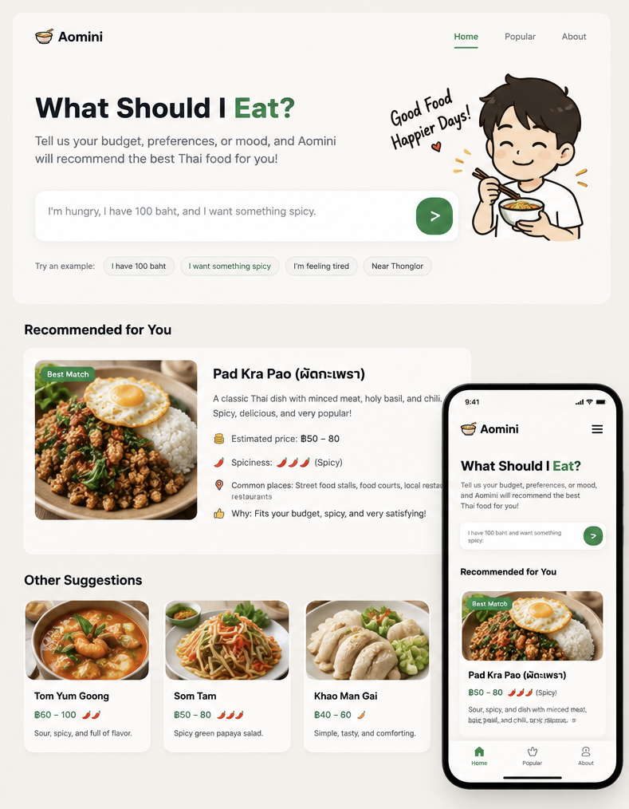
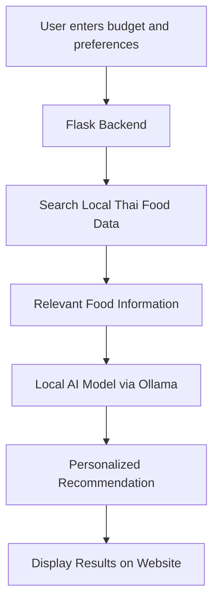

# 🍜 Aomini

### What Should I Eat? — Your AI Thai Food Companion

> Hungry? Not sure what to eat? Let Aomini decide!




*Concept preview of the Aomini web application. Final implementation may differ.*

---

## 🌟 About Aomini

**Aomini** is an AI-powered Thai food recommendation assistant designed to solve a simple everyday problem:

**"What should I eat today?"**

Instead of spending time deciding what to eat, users can tell Aomini their budget, food preferences, and current mood.

Using a locally stored Thai food knowledge base, Aomini aims to recommend suitable dishes and explain why they match the user's needs.

## 🎯 Our Goal

To explore how **local knowledge and generative AI** can work together to provide personalized, practical food recommendations.

The project focuses on Thai cuisine and everyday food choices in Thailand.

## ✨ Planned Features

- 💰 **Budget-Based Recommendations** — Find meals that fit your budget.
- 🌶️ **Taste Preferences** — Choose spicy, mild, sweet, or savory dishes.
- 😊 **Mood-Based Suggestions** — Get food ideas based on how you feel.
- 🥗 **Dietary Preferences** — Filter dishes using ingredient and dietary information.
- 🇹🇭 **Local Thai Food Knowledge** — Explore Thai dishes, prices, and ingredients.
- 💬 **Natural Language Chat** — Describe what you want in everyday language.

## 💬 Example Interaction

**User:**

> I'm hungry! I have 100 baht and want something spicy.

**Aomini:**

> 🍳 **Try Pad Kra Pao!**
>
> 💰 Estimated price: ฿60–80
>
> 🌶️ Spiciness: Spicy
>
> 🍚 Why? It's a popular Thai basil stir-fry served with rice. It's filling, flavorful, and fits your budget.

*Prices are illustrative and may vary by restaurant and location.*

## 🧠 How It Works

Aomini will combine a local language model with a structured food knowledge base.



### Local Knowledge Base

Our database will contain information such as:

| Food | Estimated Price | Spice Level | Category |
|---|---|---|---|
| Pad Kra Pao | ฿60–80 | Spicy | Rice |
| Pad Thai | ฿60–90 | Mild | Noodles |
| Tom Yum Noodles | ฿60–100 | Spicy | Soup |
| Khao Man Gai | ฿50–80 | Mild | Rice |
| Som Tam | ฿40–70 | Spicy | Salad |

*Sample data only. Prices and ingredients will be reviewed during development.*

The AI will use this information to make recommendations rather than relying only on its general knowledge.

## 🛠️ Proposed Tech Stack

| Technology | Purpose |
|---|---|
| Python | Application logic |
| Flask | Backend web framework |
| Ollama | Run the AI model locally |
| Gemma 3 | Local language model |
| CSV / JSON | Thai food knowledge base |
| HTML / CSS / JavaScript | Website interface |
| GitHub | Version control and collaboration |

## 📁 Planned Project Structure

```text
Aomini/
├── app.py
├── data/
│   └── thai_foods.csv
├── templates/
│   └── index.html
├── static/
│   ├── style.css
│   └── script.js
├── requirements.txt
├── aomini-preview.png
└── README.md
```

*This is the proposed structure. Files will be added as development progresses.*

## 🚀 Development Roadmap

- [x] Choose project idea and define objectives
- [ ] Collect and organize Thai food data
- [ ] Develop the Flask backend
- [ ] Connect the local AI model using Ollama
- [ ] Implement food recommendation logic
- [ ] Build the website interface
- [ ] Test recommendations and improve accuracy
- [ ] Complete the final demonstration

## 💻 Getting Started

Installation and setup instructions will be added once the first working version is available.

The planned application will run locally using Python, Flask, and Ollama.

## 👥 Our Team

| Name | Nickname | Student ID |
|---|---|---|
| Team Member 1 | TBD | TBD |
| Team Member 2 | TBD | TBD |
| Team Member 3 (if applicable) | TBD | TBD |

## 🎓 Academic Project

Developed for the **Generative AI — AI with Local Knowledge** assignment.

Our objective is to demonstrate how a locally running AI model can use domain-specific knowledge to answer practical, everyday questions.

---

### 🍜 Aomini — Good Food, Better Decisions.

*Made with ❤️ for food lovers in Thailand.*
