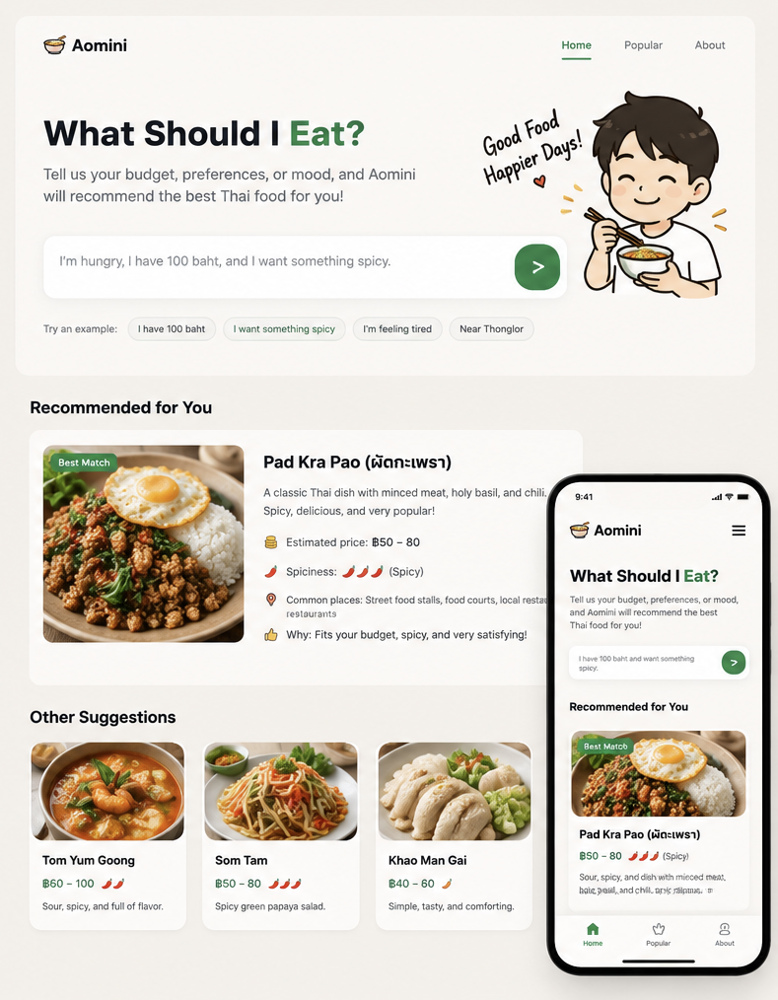

# 🍜 Aomini

### What Should I Eat? — Your Local AI Thai Food Companion

> Unsure what to eat? Ask Aomini using your own Thai food documents.



*Design concept; the current application interface may differ.*

## 🌟 About the Project

**Aomini** is a local AI assistant that helps users explore Thai food through documents they upload. It can answer questions about dishes, ingredients, dietary preferences, and prices **when those details appear in the documents**.

Our goal is to demonstrate **AI with Local Knowledge** using **RAG (Retrieval-Augmented Generation)**: the app searches relevant PDF passages before generating an answer, so users can check the original sources.

## ✨ What We Built for This Assignment

- **PDF knowledge base** — Upload multiple text-based PDFs and automatically index their content.
- **Local AI chat** — Ask Thai-food questions using **Qwen3** through **Ollama**.
- **Verifiable answers** — See source filenames, page references, and retrieved excerpts.
- **Document management** — View indexing status, open original PDFs, retry failed uploads, and delete documents.
- **Accurate document list** — Ask *“What documents are in my collection?”* to retrieve the actual uploaded filenames.

**How it works:** PDF upload → text extraction → local embeddings and search → Qwen3 answer with source references.

## 🛠️ Tech Stack

**Python · Flask · Ollama · Qwen3 (1.7B) · nomic-embed-text · pypdf · SQLite · HTML/CSS/JavaScript**

## 🚀 Run Locally (macOS)

Install [Python 3.10+](https://www.python.org/downloads/) and [Ollama](https://ollama.com/download) first. Keep Ollama running, then use:

```bash
git clone https://github.com/OfficialJOLO/Aomini.git
cd Aomini
python3 -m venv .venv
source .venv/bin/activate
python -m pip install -r requirements.txt
ollama pull qwen3:1.7b
ollama pull nomic-embed-text
python app.py
```

Open **http://127.0.0.1:5000** in your browser.

## 📚 Try It

1. Open **Document Collection** and upload Thai food PDFs.
2. Wait until each document shows **Ready**.
3. Ask a question in **Chat** and inspect its cited PDF sources.

Example questions:

- *What are the main ingredients of Pad Kra Pao?*
- *Which dishes in my documents are spicy?*
- *What documents are in my collection?*

**Class demo documents (upload locally; not included in GitHub):**

- `01_Thai_Dish_Guide.pdf` — Thai dishes, ingredients, and flavors
- `02_Soups_Curries_Noodles.pdf` — Thai soups, curries, and noodles
- `03_Budget_Food_Demo_Data.pdf` — Illustrative food prices and budget choices
- `04_Regional_Thai_Cuisine.pdf` — Regional Thai dishes
- `05_Dietary_Cautions_And_RAG_Tests.pdf` — Dietary considerations and test questions

The budget data is illustrative, not live restaurant pricing.

## 📁 Main Files

```text
Aomini/
├── app.py                # Flask application
├── knowledge.py          # PDF indexing and retrieval
├── templates/            # Web interface
├── static/               # CSS, JavaScript, assets
├── tests/                # Automated tests
├── requirements.txt
└── README.md
```

Run the application tests with `python -m unittest tests.test_app -v`.

## 👥 Team

| Name | Nickname | Student ID |
|---|---|---|
| Jinyong Park | Jay | 6858014756 |
| Nawiphad Kositkun | Aom | 6858033656 |
| Syed Aamiz Raza | Aamiz | 6858024056 |

**Chulalongkorn University · Generative AI — AI with Local Knowledge**

*🍜 Aomini — Good Food, Better Decisions.*
